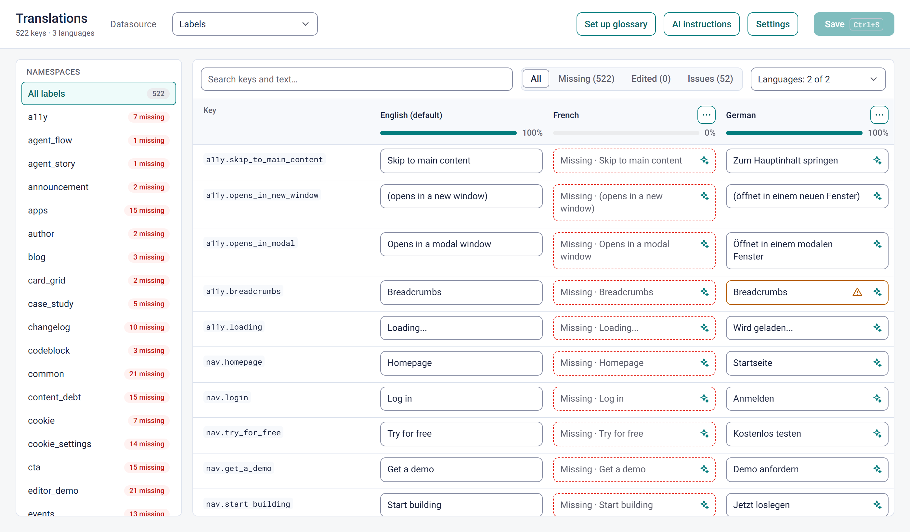
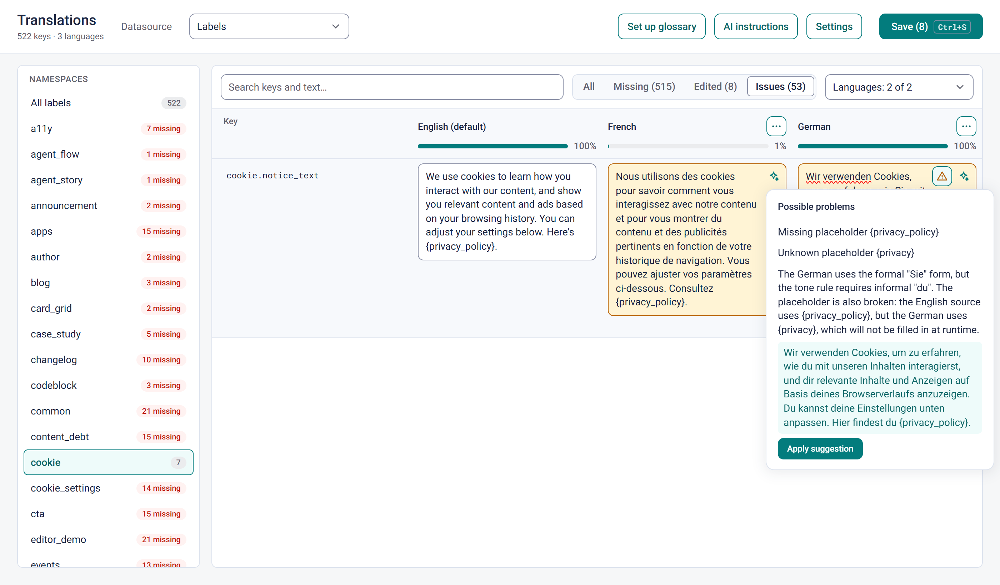
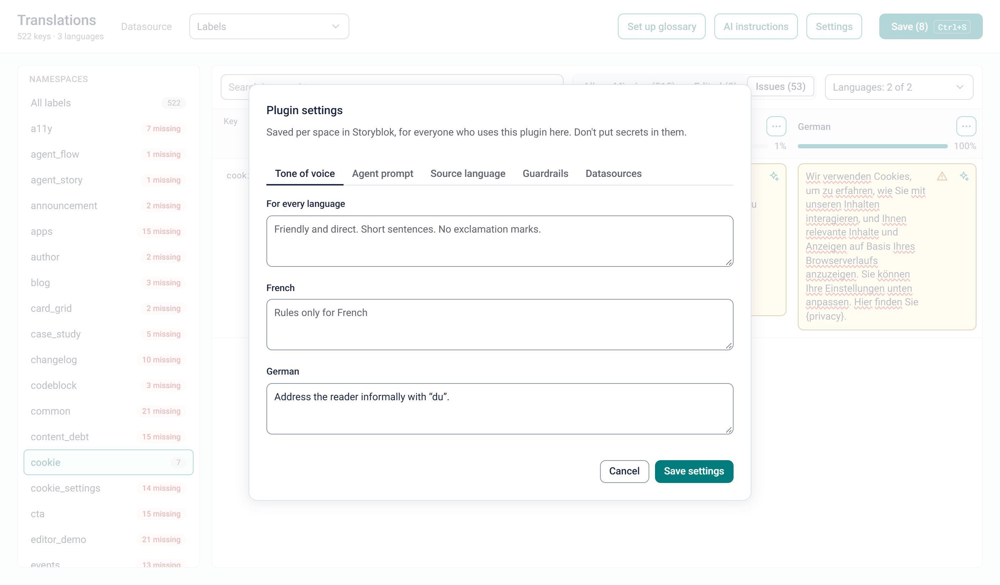

# Label Translations: a Storyblok Space Plugin

Translate the labels in your Storyblok **datasources** with every language side by side, right inside Storyblok. Built as a **Space Plugin** with Next.js and Vercel's [ui-sdk](https://ui-sdk.dev), styled with Storyblok's own design tokens, and using Claude for AI translation and review.



| Guardrails and AI review | Per-space settings |
| --- | --- |
|  |  |

## Why

UI labels (buttons, form errors, aria labels, cookie banner texts) often live in a Storyblok datasource: each entry has a key and a default text, and each **dimension** adds a language. Storyblok's datasource screen shows one dimension at a time. This plugin loads all of them at once, so you can compare, fill and check hundreds of labels across languages quickly.

## Features

- **Every language side by side.**
  - One row per key and one column per language.
  - Namespaces (`nav.*`, `form.*`, …) in a sidebar with "missing" counts.
  - Search across keys and all languages.
  - All / Missing / Edited / Issues filters, and a completion bar per language.
- **AI translation** with Claude Haiku. Translate one cell, or everything that's missing in a language.
  - The whole datasource goes along as context, so terminology stays consistent.
  - Results are drafts you review before saving.
- **Guardrails and AI review.**
  - Instant guardrails run in the browser: broken `{placeholders}`, much longer than the source, untranslated, stray spaces, final punctuation, glossary terms.
  - "Review with AI" finds real problems and offers one-click fixes.
- **Glossary as a datasource.** "Set up glossary" creates a `translation-glossary` datasource with your languages. Its terms are added to every AI prompt and checked in every cell.
- **Per-space settings**, stored in Storyblok's space-level plugin settings:
  - tone of voice (general and per language);
  - editable agent prompts for translation and review;
  - source language;
  - guardrail thresholds;
  - which datasources to show.
- **Transparent AI.** "AI instructions" shows the exact system prompt for each language.
- **Many languages.**
  - A language picker, and a column order per person (column menu → move).
  - Horizontal scrolling with a sticky key column.
- **Saving back to Storyblok:**
  - through the Management API, rate-limited, with progress and retries;
  - `Ctrl/Cmd + S` to save;
  - unsaved drafts survive a reload.
- **Starting from zero.** In a space without a datasource that has dimensions, the plugin offers to create one, with your languages and optional starter labels.
- **No database.** Labels and the glossary live in datasources, settings in Storyblok's plugin settings, and view preferences in the browser.

## How it works

| Part | What it does |
| --- | --- |
| **Space Plugin** | A web app Storyblok loads in an iframe. [`@storyblok/app-extension-auth`](https://github.com/storyblok/pluginsblok) handles OAuth; the space comes from the verified session, so one deployment works in every space it's installed in. |
| **Management API** | Reads the default values plus one request per dimension and merges them by entry id. Writes go through `PUT /datasource_entries/:id` with `dimension_id`. |
| **ui-sdk** | All controls: Select, Listbox, Input, Textarea, SegmentedControl, Menu, Popover, Dialog, Tabs, Field, NumberInput, CheckboxGroup, Button, Progress, Meter and Toast. Accessible and keyboard friendly; styled through `--ui-*` variables set from Storyblok's design tokens. |
| **Claude** | `claude-haiku-5-5` with structured output, the datasource as a cached system prompt, and the glossary and tone of voice appended. |

## Build your own Space Plugin with an AI agent

This repo also ships a generator prompt for **any** Space Plugin, not just this one. It covers OAuth, the Management API, storage without a database, a Storyblok look on ui-sdk, optional AI features, and registering the plugin.

- **As a prompt:** point your coding agent at [`generator/PROMPT.md`](generator/PROMPT.md) (via its raw GitHub URL) and replace the example under "The app to build" with your idea.
- **As an Agent Skill:** `npx skills add <owner>/<repo> --skill storyblok-space-plugin` installs [`skills/storyblok-space-plugin`](skills/storyblok-space-plugin/SKILL.md) for Claude Code and other agents.

`generator/PROMPT.md` is the source. After editing it, run `node generator/build-skill.mjs` to regenerate the skill.

## Requirements

- Node.js 20 or newer
- A Storyblok account that can register a Space Plugin (Organization or Partner Portal → Extensions)
- A public HTTPS URL for the app: [ngrok](https://ngrok.com) during development, or your deployment
- Optional: an [Anthropic API key](https://platform.claude.com) for the AI features. Everything else works without one.

## Setup

1. **Install**

   ```bash
   npm install
   cp .env.example .env
   ```

2. **Start the app and a tunnel**

   ```bash
   npm run dev
   ngrok http 3000
   ```

   Put the HTTPS URL ngrok prints into `.env` as `STORYBLOK_PLUGIN_BASE_URL`. A free ngrok static domain keeps it from changing between sessions.

3. **Register the Space Plugin in Storyblok.** Go to Organization (or Partner Portal) → Extensions → New Extension, choose type **Sidebar**, then:
   - **General:** copy the slug into `STORYBLOK_SPACE_PLUGIN_SLUG`.
   - **OAuth 2.0 and Pages:** copy the Client Identifier and Client Secret into `.env`, and set:
     - Index to your page: `https://<your-url>`
     - Redirection endpoint: `https://<your-url>/api/connect/callback`
   - **Details:** turn on **Enable settings on space level** (used for the plugin's Settings).

4. **Install it into a space** with the install link (General tab), then open it from the space's sidebar under Apps. On the first open, approve the OAuth consent. It may bounce once through a short `/401` page back into Storyblok, which is expected because the session cookie is partitioned.

### Environment variables

| Variable | Required | |
| --- | --- | --- |
| `STORYBLOK_PLUGIN_CLIENT_IDENTIFIER` | yes | From the plugin's OAuth 2.0 tab |
| `STORYBLOK_PLUGIN_CLIENT_SECRET` | yes | From the plugin's OAuth 2.0 tab. Keep it secret. |
| `STORYBLOK_PLUGIN_BASE_URL` | yes | The public HTTPS URL Storyblok loads the plugin from |
| `STORYBLOK_SPACE_PLUGIN_SLUG` | yes | The plugin's slug, used to find its space-level settings |
| `ANTHROPIC_API_KEY` | no | Turns on AI translation and review |
| `STORYBLOK_PREVIEW_TOKEN` | no | A public CDN token for the development-only `/preview` route |

## Development

```bash
npm run dev     # dev server
npm run build   # production build
npm run lint
```

`/preview` (development only, needs `STORYBLOK_PREVIEW_TOKEN`) renders the editor with read-only CDN data and simulated saves, with no Storyblok login. It's useful for working on the UI. AI features run for real there.

### Project structure

```
src/
  app/
    page.tsx              the plugin page: session check, loads data, renders the editor
    actions.ts            server actions: save, translate, review, glossary, settings, setup
    401/page.tsx          sends the first OAuth consent back into Storyblok
    preview/              development-only preview with CDN data
  pages/api/connect/      OAuth handler from @storyblok/app-extension-auth
  components/             editor, table rows, settings and AI dialogs, setup screen, loading state
  lib/
    storyblok/            Management API client, session, types
    prompts.ts            the AI prompts, shared by the requests and the "AI instructions" dialog
    translate.ts          Claude requests (structured output, prompt caching)
    checks.ts             translation checks and glossary parsing
    settings.ts           space-level settings with defaults
  auth.ts                 OAuth configuration
```

## Deploy

Deploy it like any Next.js app, for example on [Vercel](https://vercel.com/new). Set the environment variables there, and point the plugin's page and redirection URLs at the deployment.

## Notes

- The Management API allows 3 requests per second on Starter plans and 6 on paid plans. Saves are paced and retried.
- AI results are always drafts. Nothing reaches Storyblok until someone presses Save.
- AI features only run for signed-in Storyblok users of a space where the plugin is installed.
- Space-level settings are for non-sensitive configuration only.
